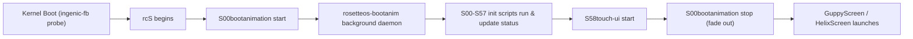

# RosetteOS Boot Animation Engine (`rosetteos-bootanim`)

Lightweight, high-performance, standalone boot animation engine for RosetteOS on the Ingenic X2000 (MIPS32 / Halley5 / 480x272 LCD fbdev).

---

## 1. Overview & Architecture

During early boot, between Linux kernel initialization and GuppyScreen/HelixScreen startup, the printer display previously displayed a static frozen screen. `rosetteos-bootanim` provides smooth, elegant visual feedback throughout the entire boot sequence.

### Key Capabilities:
- **Direct Framebuffer Access**: Renders directly to `/dev/fb0` (480x272 @ 32bpp XRGB8888) with an offscreen double/triple-buffering memory model, ensuring zero flicker and zero tearing.
- **Procedural Vector Engine**: Renders an animated geometric Rosette emblem with dynamic cyan-blue-purple brand gradients (`#00d2ff` -> `#3a7bd5` -> `#8a2be2`), radiant breathing halo, and an animated sweeping indeterminate loading wave.
- **Dynamic Boot Milestones**: Reads `/run/rosetteos-boot-status` in real-time, reflecting live startup progress across firmware subsystems:
  - `S01wifi`: *"Connecting network..."*
  - `S01zram`: *"Configuring memory..."*
  - `S04rosetteos-factory-seed`: *"Checking printer configuration..."*
  - `S05rosetteos-activate`: *"Activating runtime layers..."*
  - `S50webcam`: *"Initializing camera..."*
  - `S54rosetteos-host-mcu`: *"Connecting controller board..."*
  - `S55klipper`: *"Starting Klipper firmware..."*
  - `S56moonraker`: *"Starting Moonraker API..."*
  - `S58touch-ui`: *"Starting touchscreen interface..."*
- **Seamless Hand-Off**: On `SIGTERM` (sent by `S58touch-ui` before starting the touchscreen interface), smoothly fades out over ~250ms, releases framebuffer memory, and exits cleanly.
- **Ultra-Lightweight Resource Profile**:
  - Binary size: ~700 KB (statically linked MIPS32 executable).
  - Memory consumption: < 1.5 MB RAM total.
  - CPU usage: ~1% CPU at 30 FPS via monotonic `nanosleep()` frame pacing.
  - OOM Priority: Tier 600 (`ROSETTEOS_ADJ_BOOTANIM`), fully expendable without threatening critical printer services.

---

## 2. Boot Lifecycle Integration



---

## 3. Building

### Native Host Build (x86_64 for testing/verification)
```sh
make -C tools/rosetteos-bootanim
```

### Target MIPS Cross-Compilation
```sh
make -C tools/rosetteos-bootanim mips
```
This invokes `vendor/system/prebuilts/toolchains/mips-gcc720-glibc238/bin/mips-linux-gnu-gcc` with `-EL -static -O2`, strips the binary, and installs it into `scripts/build/overlay/usr/bin/rosetteos-bootanim`.

---

## 4. CLI Options

| Flag | Description |
|---|---|
| `--fb <PATH>` | Framebuffer device path (default: `/dev/fb0`) |
| `--status-file <PATH>` | Path to dynamic status file (default: `/run/rosetteos-boot-status`) |
| `--fps <N>` | Target frame rate (default: `30`) |
| `--frames <N>` | Render N frames and exit (useful for automated testing) |
| `--headless` | Run in memory without opening fbdev (for CI verification) |
| `--output-frame <PATH>` | Render one frame to binary PPM format and exit |
| `--daemon` | Fork into background daemon |
| `-h`, `--help` | Show usage information |
